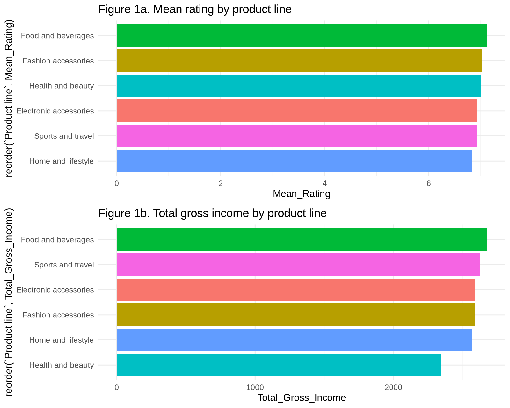
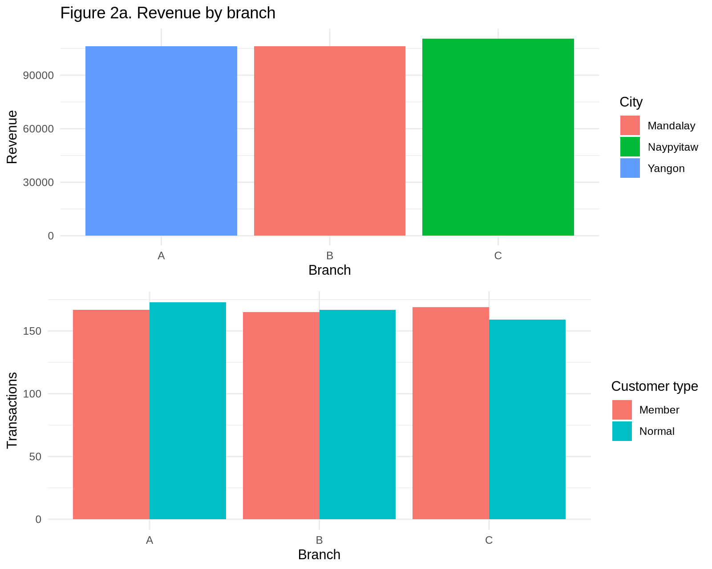
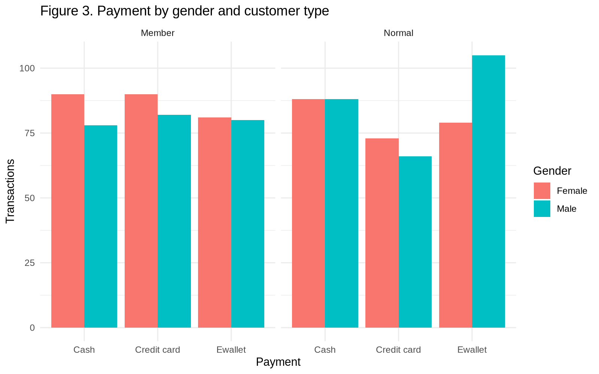
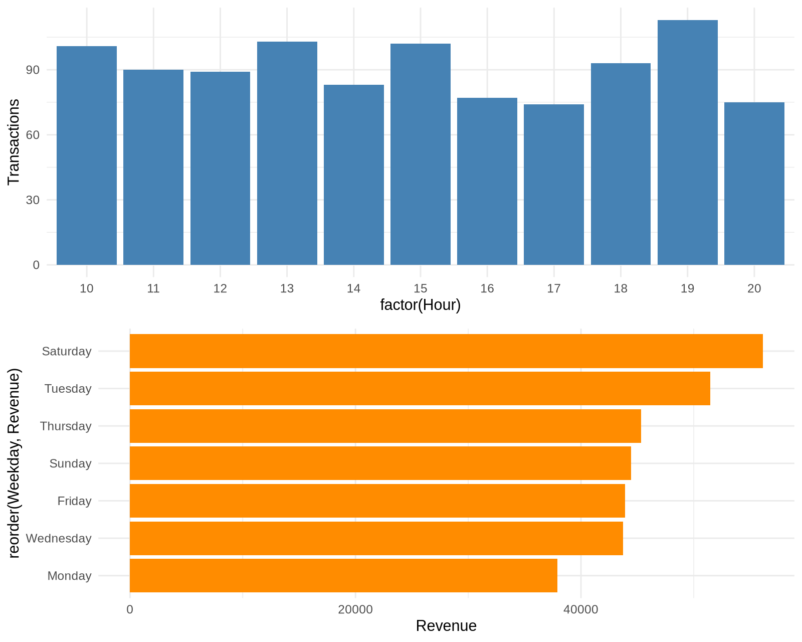
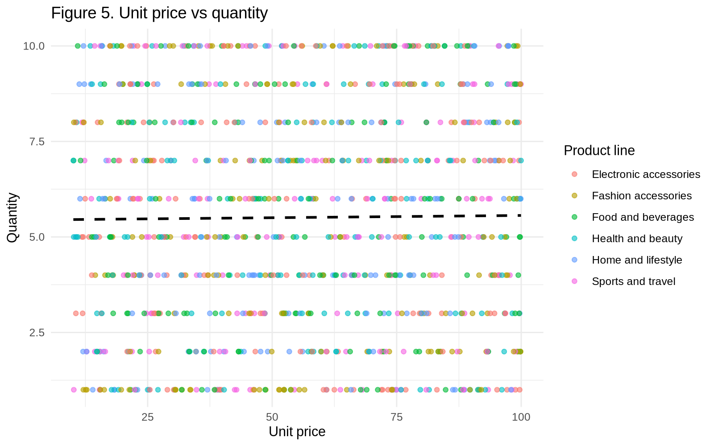

<p align="center">
  <h1 align="center">Supermarket Sales Analysis with R</h1>
  <p align="center"><b>FA-II Activity · Statistical Data Analysis using R (SDAUR) · Units I–IV</b></p>
  <p align="center">
    
    
    
    
  </p>
</p>

<p align="center">
  A complete, reproducible R project on <b>1,000 supermarket transactions</b> —
  five analytical problem statements, executed code, verified numbers,
  publication-style charts, and a submission-ready report.<br/>
  <i>Code is written in the exact style of the provided stock-market sample — banner, <code>View()</code>, <code>S1/S2/F1/M1</code> blocks, <code>CENTRAL TENDENCIES / DISPERSION / CV / stat.desc / corrplot</code> sections and <code>#problem statement → #conclusion:</code> blocks — with all logic kept for the supermarket data.</i>
</p>

---

## Team

| Name | PRN |
|:---|:---|
| Aditya Kuwar | 125B1B097 |
| Jeevan Sagale | 125B1B080 |
| Vedant Hire | 125B1B099 |
| Tanay Daware | 125B1B098 |

*Submitted to Dr. Sujata Bhamre · Dept. of AS&H, PCCOE · AY 2026-27, Semester I*

## Problem statements

| # | Question | Method |
|:---|:---|:---|
| PS1 | **Product Line Performance & Satisfaction** — how do average Rating and gross income vary across product lines? | Grouped summaries, one-way ANOVA ×2 |
| PS2 | **Geographical & Branch Sales Comparison** — does revenue and customer-type mix differ across branches? | Grouped summaries, one-way ANOVA, chi-square independence |
| PS3 | **Payment Method Demographics** — which payment methods do Gender × Customer-type segments prefer? | Cross-tabs, segment shares, chi-square ×2 |
| PS4 | **Peak Shopping Hours & Days** — when are volume and order totals highest? | Hourly/weekday summaries, chi-square goodness-of-fit ×2 |
| PS5 | **Profitability & Pricing Elasticity** — how does Unit price relate to Quantity and gross income? | Pearson correlation ×2, scatterplot, regression exercise |

## Headline results

| Finding | Value |
|:---|:---|
| Total revenue | **322,966.75** (mean invoice 322.97) |
| Top satisfaction | **Food and beverages — mean rating 7.11** (ANOVA ns, p = 0.746) |
| Top gross income | **Food and beverages — 2,673.56 total** (ANOVA ns, p = 0.890) |
| Top branch revenue | **C / Naypyitaw — 110,568.71** (ANOVA ns, p = 0.413; mix chi-square ns, p = 0.811) |
| Payment segments | Females → **Cash 35.5%** · Males → **Ewallet 37.1%** · Normal → **Ewallet 36.9%** (chi-squares ns) |
| Peak hour / day | **19:00 (113 invoices)** · **Saturday (164 invoices, 56,120.81)** |
| Price–quantity link | Pearson **r = 0.011** (p = 0.734) — **no elasticity visible** |
| Price–gross income | Pearson **r = 0.634** (invoice arithmetic, not causal) |

## Visual results

**PS1 — Mean rating and total gross income by product line.** Food and beverages leads
both; line differences are small vs within-line variation (both ANOVAs ns).

<p align="center"></p>

**PS2 — Revenue and Member/Normal mix by branch.** Branch C leads revenue with the same
~50/50 customer mix as A and B (ANOVA p = 0.413; chi-square p = 0.811).

<p align="center"></p>

**PS3 — Payment method by gender and customer type.** Cash leads among females, Ewallet
among males and Normal customers — descriptively only (chi-squares p = 0.229, p = 0.074).

<p align="center"></p>

**PS4 — Transactions by hour and revenue by weekday.** 19:00 peaks, afternoons carry the
most traffic, Saturday is strongest; uniformity tests non-significant (p = 0.050, p = 0.244).

<p align="center"></p>

**PS5 — Unit price vs quantity by product line.** No linear link (r = 0.011): expensive
items are not bought in smaller amounts here. Profitability follows revenue (constant margin).

<p align="center"></p>

## Dataset

`R_Unit1_to_Unit4_Project/data/supermarket_sales.csv` — 1,000 invoices × 17 columns,
3 branches, 6 product lines, Jan–Mar 2019, store hours 10:00–20:00.
Zero missing values, zero duplicates, source file preserved untouched.

> `Total = 1.05 × Quantity × Unit price` in every row (`Tax 5%` = `gross income`,
> constant margin) — models on these columns are documented as honest
> model-fitting exercises, not causal discoveries.

## Project layout

```
R_Unit1_to_Unit4_Project/
├── main.R                      ← ONE SINGLE FILE — all Unit I–IV + PS1–PS5 + figures + verification merged here
├── outputs/reports/            ← regenerated CSV/TXT tables + test results
├── outputs/plots/              ← exploratory plots
├── report/figures/             ← the 5 figures above + cover logo
├── report/Supermarket_Sales_FA2_Report.{docx,pdf}  ← final report
├── data/supermarket_sales.csv  ← untouched source data
└── PLAN.md · REPORT_PLAN.md · REPORT_VALIDATION.md · PROGRESS.md · UNIT_MAPPING.md
```

Also in this repo root: `course_materials/` (course PDFs + practice datasets),
`SDAUR.zip` (original course archive), `Sample Report for FA2 Activity.docx`
(instructor template), `Supermarket_Sales_R_Project_Complete.zip` (packaged
project snapshot), and `Junk/` (superseded drafts, kept for reference).

## Run it

```r
# In RStudio: open R_Unit1_to_Unit4_Project.Rproj, then run main.R
# Or from the terminal, in the project root:
Rscript main.R
```

`main.R` is 276 lines — all Unit I–IV + PS1–PS5 + figures + verification in one file, no `scripts/` folder.
Packages `dplyr`/`ggplot2` install automatically; `tidyr` is optional.
`main.R` verifies the run from the raw CSV and halts on mismatch — **verified** in the submitted run
(log: `outputs/reports/run_log.txt`).

## Report & docs

- Final report: `report/Supermarket_Sales_FA2_Report.docx` (editable) + `.pdf` (print-ready),
  built to the instructor's sample format with real figures and traced numbers.
- Full audit trail: `PLAN.md`, `REPORT_PLAN.md`, `REPORT_VALIDATION.md`, `PROGRESS.md`.
- Viva prep: `oral_exam/viva_questions_and_functions.md`.

<p align="center"><i>Branch, submission date and signatures to be filled at submission.</i></p>
