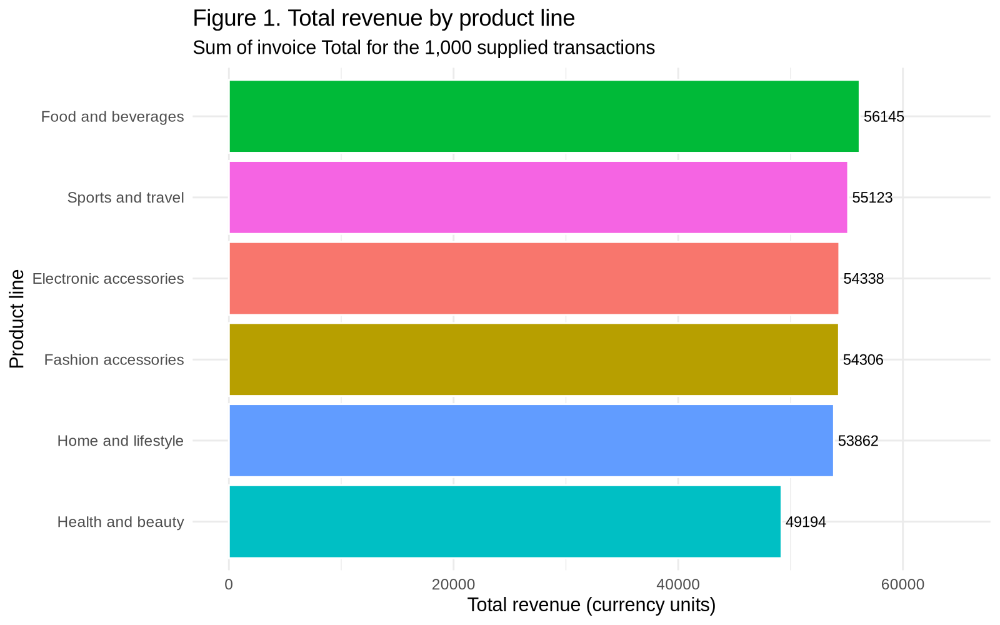
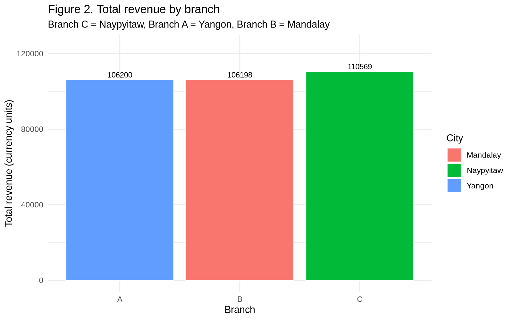
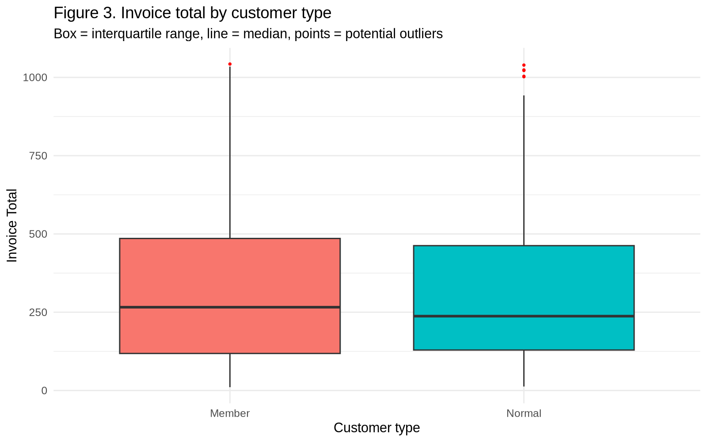
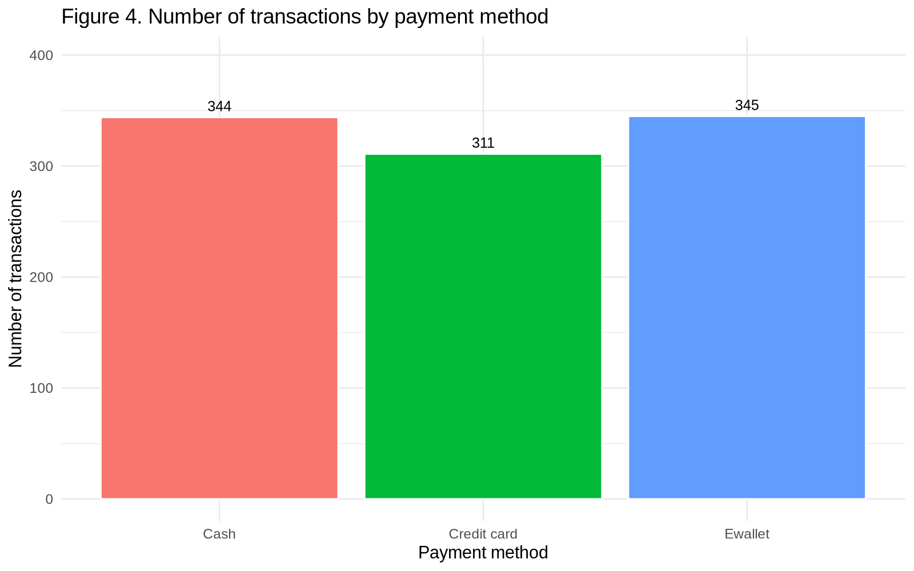
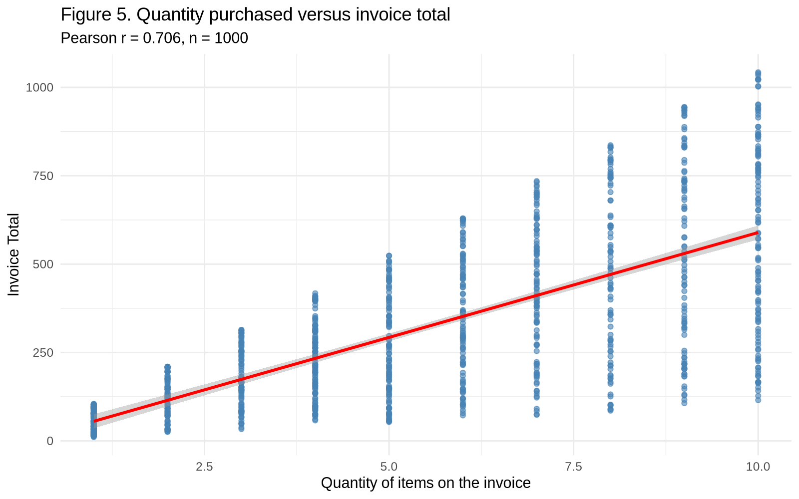
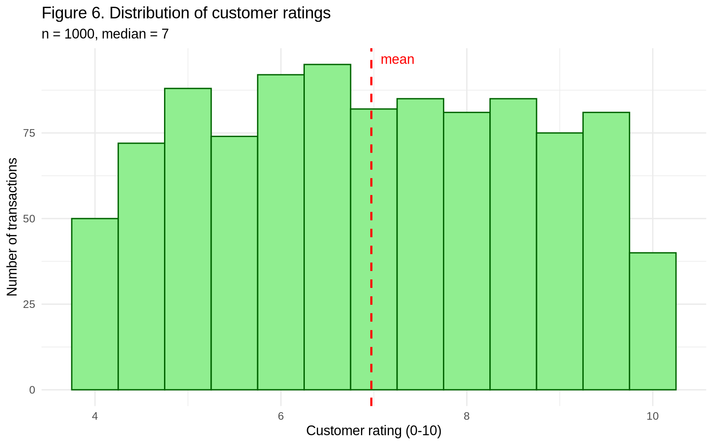
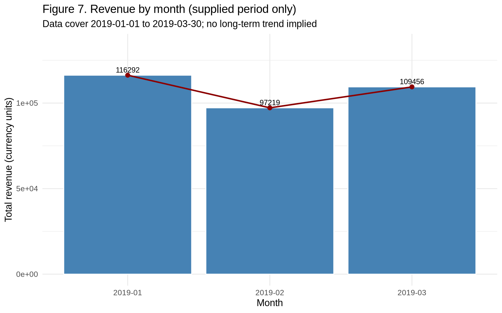

<p align="center">
  <h1 align="center">Supermarket Sales Analysis with R</h1>
  <p align="center"><b>FA-II Activity · Statistical Data Analysis using R (SDAUR) · Units I–IV</b></p>
  <p align="center">
    
    
    
    
  </p>
</p>

<p align="center">
  A complete, reproducible R project on <b>1,000 supermarket transactions</b> —
  seven analytical problem statements, executed code, verified numbers,
  publication-style charts, and a submission-ready report.
</p>

---

## Team

| Name | PRN |
|:---|:---|
| Aditya Kuwar | 125B1B097 |
| Jeevan Sagale | 125B1B080 |
| Vedant Hire | 125B1B099 |
| Tanay Daware | 125B1B098 |

*Submitted to Dr. Sujata Bhamre · Dept. of AS&H, PCCOE · AY 2026-27, Semester I*

## Dataset

`R_Unit1_to_Unit4_Project/data/supermarket_sales.csv` — 1,000 invoices × 17 columns,
3 branches (A/Yangon, B/Mandalay, C/Naypyitaw), 6 product lines, Jan–Mar 2019.
Zero missing values, zero duplicates, source file preserved untouched.

> `Total = 1.05 × Quantity × Unit price` in every row (`Tax 5%` = `gross income`,
> constant margin) — regressions on these columns are documented as honest
> model-fitting exercises, not causal discoveries.

## Headline results

| Finding | Value |
|:---|:---|
| Total revenue | **322,966.75** (mean 322.97 · median 253.85) |
| Top product line | **Food and beverages — 56,144.84** |
| Top branch | **C / Naypyitaw — 110,568.71** |
| Member vs Normal means | 327.79 vs 318.12 — Welch t-test **not significant** (p = 0.534) |
| Quantity ↔ Total | Pearson **r = 0.706** (p < 1e-150) |
| Rating ↔ Total | Pearson **r = −0.036** (p = 0.250, not significant) |
| Branch / product-line / payment ANOVAs | all **not significant** at α = 0.05 |
| Best month / weekday | **January (116,291.87)** · **Saturday (56,120.81)** |

## Visual results

**PS1 — Revenue by product line.** Food and beverages leads; Health and beauty trails.
ANOVA finds no significant mean difference across lines (F = 0.338, p = 0.890).

<p align="center"></p>

**PS2 — Revenue by branch.** Branch C tops both revenue and mean invoice, but branch
means don't differ significantly (F = 0.885, p = 0.413).

<p align="center"></p>

**PS3 — Member vs Normal invoice totals.** Overlapping distributions; the 9.67 gap in
means is not significant (t = 0.622, p = 0.534).

<p align="center"></p>

**PS4 — Transactions by payment method.** Ewallet (345) ≈ Cash (344) ≫ Credit card (311);
mean totals indistinguishable (F = 0.081, p = 0.922).

<p align="center"></p>

**PS5 — Quantity vs invoice total.** Strong positive association (r = 0.706) — expected,
since totals are computed from quantity and unit price. Not causal evidence.

<p align="center"></p>

**PS6 — Customer ratings.** Centered near 7 (mean 6.97, median 7.0, range 4–10) with
essentially no link to invoice size (r = −0.036, p = 0.250).

<p align="center"></p>

**PS7 — Monthly revenue.** January peaks, February dips, March recovers — a 3-month
sample description, not a seasonal trend.

<p align="center"></p>

## Project layout

```
R_Unit1_to_Unit4_Project/
├── main.R                      ← run this (entry point)
├── scripts/                    ← unit1–unit4, problem_statements (PS1–PS7),
│                                  data_analysis, report_figures, verify_results
├── outputs/reports/            ← regenerated CSV/TXT tables + test results
├── outputs/plots/              ← exploratory plots
├── report/figures/             ← the 7 figures above + cover logo
├── report/Supermarket_Sales_FA2_Report.{docx,pdf}  ← final report
├── data/supermarket_sales.csv  ← untouched source data
└── PLAN.md · REPORT_PLAN.md · REPORT_VALIDATION.md · PROGRESS.md · UNIT_MAPPING.md
```

## Run it

```r
# In RStudio: open R_Unit1_to_Unit4_Project.Rproj, then run main.R
# Or from the terminal, in the project root:
Rscript main.R
```

Packages `dplyr`/`ggplot2` install automatically; `tidyr` is optional.
`scripts/verify_results.R` independently recomputes every headline number from the
raw CSV and halts on any mismatch — **20/20 matched** in the submitted run
(log: `outputs/reports/run_log.txt`).

## Report & docs

- Final report: `report/Supermarket_Sales_FA2_Report.docx` (editable) + `.pdf` (print-ready),
  built to the instructor's sample format with real figures and traced numbers.
- Full audit trail: `PLAN.md`, `REPORT_PLAN.md`, `REPORT_VALIDATION.md`, `PROGRESS.md`.
- Viva prep: `oral_exam/viva_questions_and_functions.md`.

<p align="center"><i>Branch, submission date and signatures to be filled at submission.</i></p>
